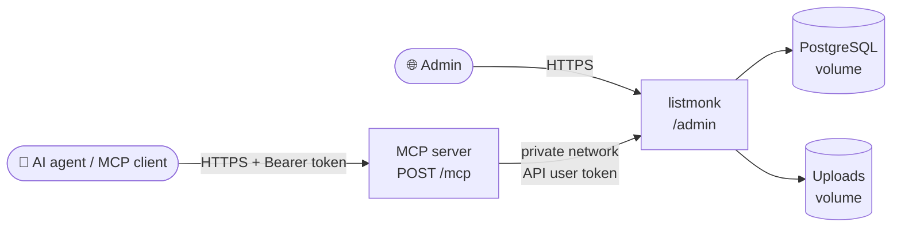

# Listmonk + MCP for railway.app


[listmonk](https://listmonk.app) is a fast, self-hosted newsletter and mailing list manager. This template deploys listmonk together with PostgreSQL and the [listmonk MCP server](https://github.com/kieksme/mcp-listmonk), so AI agents such as Claude, Cursor or ChatGPT can manage lists, subscribers, campaigns and templates over the Model Context Protocol. Everything is wired up on first boot: no setup wizard, no manual API user, no copy-pasting tokens.

[](https://railway.com/deploy/TEMPLATE_CODE?referralCode=2_sIT9&utm_medium=integration&utm_source=template&utm_campaign=generic)

## 🏗️ Architecture



| Service | Source | Public | Healthcheck | Volume |
|---------|--------|--------|-------------|--------|
| Postgres | `ghcr.io/railwayapp-templates/postgres-ssl:18` | no | built in | `/var/lib/postgresql/data` |
| Listmonk | `listmonk/Dockerfile` (listmonk v6) | yes | `/health` | `/listmonk/uploads` |
| MCP | `mcp/Dockerfile` (`ghcr.io/kieksme/mcp-listmonk`) | yes | `/healthz` | none |

## ✨ What happens on first boot

1. listmonk waits for Postgres and runs `--install --idempotent`, creating the schema, a super admin (`LISTMONK_ADMIN_USER` / `LISTMONK_ADMIN_PASSWORD`) and an API user (`LISTMONK_API_USER`).
2. The API user's token is set to the generated `LISTMONK_API_TOKEN` (stored as a SHA-256 hash, exactly like listmonk does it). The MCP service reads the same variable through a reference, so it can talk to listmonk right away.
3. `app.root_url` is set to the public Railway domain, so links in emails point to the right place.
4. On every later start the install step is skipped, pending migrations run (`--upgrade`) and the API token is synced again. Changing `LISTMONK_API_TOKEN` and redeploying rotates the token.

The generated install token printed by listmonk is filtered out of the logs, and no secret is written to the logs.

## 🔑 Credentials

All secrets are generated per deployment:

| Variable | Service | Purpose |
|----------|---------|---------|
| `LISTMONK_ADMIN_USER` / `LISTMONK_ADMIN_PASSWORD` | Listmonk | Login for the web UI at `/admin` |
| `LISTMONK_API_USER` / `LISTMONK_API_TOKEN` | Listmonk, MCP | API user used by the MCP server |
| `MCP_AUTH_TOKEN` | MCP | Bearer token your MCP client must send |
| `POSTGRES_PASSWORD` | Postgres | Database password |

Find them under **Variables** of each service. The admin credentials only apply on the very first boot; change the password later in the listmonk UI.

## 🤖 Connect an MCP client

The MCP endpoint is `https://` + the MCP service's public domain + `/mcp` (Streamable HTTP, stateless). Send the token as `Authorization: Bearer` header.

Cursor (`~/.cursor/mcp.json`), Claude Code and other clients that accept remote servers:

```json
{
  "mcpServers": {
    "listmonk": {
      "url": "https://YOUR-MCP-DOMAIN.up.railway.app/mcp",
      "headers": { "Authorization": "Bearer YOUR_MCP_AUTH_TOKEN" }
    }
  }
}
```

Claude Code CLI:

```bash
claude mcp add --transport http listmonk https://YOUR-MCP-DOMAIN.up.railway.app/mcp \
  --header "Authorization: Bearer YOUR_MCP_AUTH_TOKEN"
```

The server exposes 72 tools (subscribers, lists, campaigns, templates, media, imports, bounces, settings, transactional mail and more). Limit them with `LISTMONK_ENABLED_TOOLS` (for example `subscribers,lists`) or per request with `/mcp?tools=subscribers,lists`.

## ⚙️ Environment

### Listmonk

| Variable | Default | Description |
|----------|---------|-------------|
| `LISTMONK_db__*` | references to Postgres | Database connection |
| `LISTMONK_ADMIN_USER` | `admin` | Super admin created on first boot |
| `LISTMONK_ADMIN_PASSWORD` | generated | Super admin password (first boot only) |
| `LISTMONK_API_USER` | `mcp` | API user for the MCP server |
| `LISTMONK_API_TOKEN` | generated | API token, synced on every start |
| `LISTMONK_ROOT_URL` | public domain | Initial `app.root_url` |
| `PORT` | `9000` | HTTP port |

### MCP

| Variable | Default | Description |
|----------|---------|-------------|
| `LISTMONK_URL` | private listmonk URL | listmonk base URL |
| `LISTMONK_API_USER` / `LISTMONK_API_TOKEN` | references to Listmonk | listmonk API credentials |
| `MCP_AUTH_TOKEN` | generated | Bearer token(s), comma-separated for rotation |
| `MCP_SERVER_AUTH_TOKEN` | `MCP_AUTH_TOKEN` | Same token for MCP server 1.x |
| `MCP_ALLOWED_HOSTS` | public domain, localhost | Allowed `Host` headers |
| `LISTMONK_ENABLED_TOOLS` | all | Optional tool filter |
| `PORT` | `3000` | HTTP port |

## 📬 Sending email

listmonk needs an SMTP server to send campaigns. Configure it in the listmonk UI under **Settings → SMTP** (for example Amazon SES, Postmark, Resend, Brevo or your own server). Until then everything else works, including the MCP tools.

## 💾 Persistence and backups

Postgres stores lists, subscribers and campaigns. The listmonk volume keeps uploaded media. Enable Railway volume backups for both before production use.

## 🔄 Upgrades

Renovate keeps the listmonk and MCP image versions in `listmonk/Dockerfile` and `mcp/Dockerfile` up to date. Redeploying runs the listmonk database migrations automatically.

## 🧪 Local

```bash
cp .env.example .env
docker build -t listmonk-railway listmonk
docker build -t listmonk-mcp-railway mcp
```

Run Postgres, then start both images with the variables from `.env` plus the `LISTMONK_db__*` connection settings.

## 💬 Support

Questions or feedback? Open an issue in [vergissberlin/railwayapp-listmonk-mcp](https://github.com/vergissberlin/railwayapp-listmonk-mcp/issues).

<!-- footer -->
---

[](https://github.com/vergissberlin/railwayapp-airbyte) [](https://github.com/vergissberlin/railwayapp-airflow) [](https://github.com/vergissberlin/railwayapp-cloudbeaver-ce) [](https://github.com/vergissberlin/railwayapp-codimd) [](https://github.com/vergissberlin/railwayapp-django) [](https://github.com/vergissberlin/railwayapp-email) [](https://github.com/vergissberlin/railwayapp-fastapi) [](https://github.com/vergissberlin/railwayapp-flask) [](https://github.com/vergissberlin/railwayapp-flowise) [](https://github.com/vergissberlin/railwayapp-gitlab) [](https://github.com/vergissberlin/railwayapp-grafana) [](https://github.com/vergissberlin/railwayapp-homeassistant) [](https://github.com/vergissberlin/railwayapp-influxdb) [](https://github.com/vergissberlin/railwayapp-mjml) [](https://github.com/vergissberlin/railwayapp-mongodb) [](https://github.com/vergissberlin/railwayapp-mqtt) [](https://github.com/vergissberlin/railwayapp-mysql) [](https://github.com/vergissberlin/railwayapp-n8n) [](https://github.com/vergissberlin/railwayapp-nodejs) [](https://github.com/vergissberlin/railwayapp-nodered) [](https://github.com/vergissberlin/railwayapp-opensearch) [](https://github.com/vergissberlin/railwayapp-openwebui) [](https://github.com/vergissberlin/railwayapp-operately) [](https://github.com/vergissberlin/railwayapp-outerbase-studio) [](https://github.com/vergissberlin/railwayapp-postgresql) [](https://github.com/vergissberlin/railwayapp-redis) [](https://github.com/vergissberlin/railwayapp-typo3)
